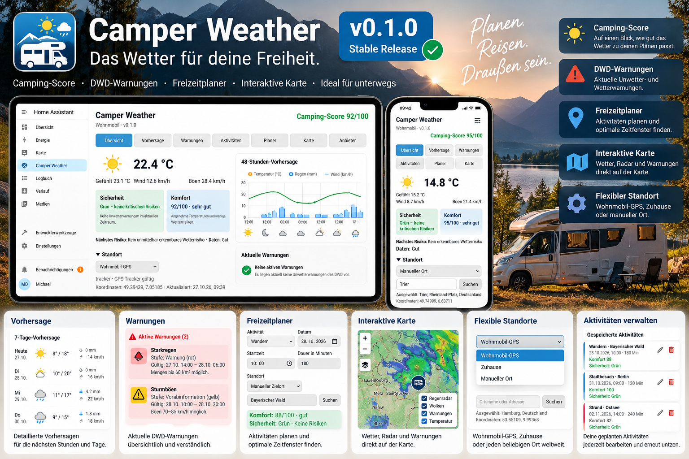
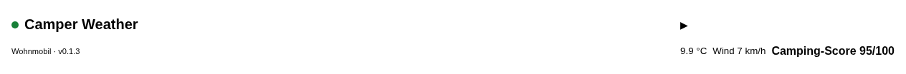
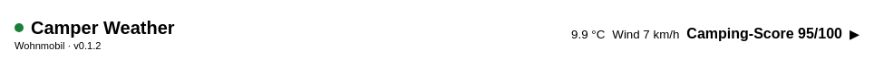
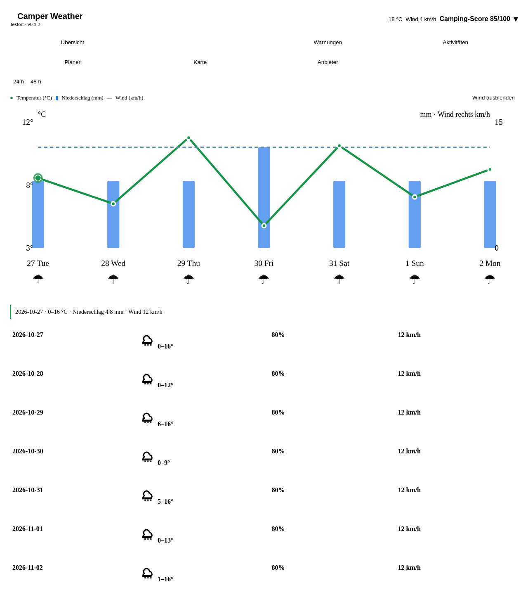
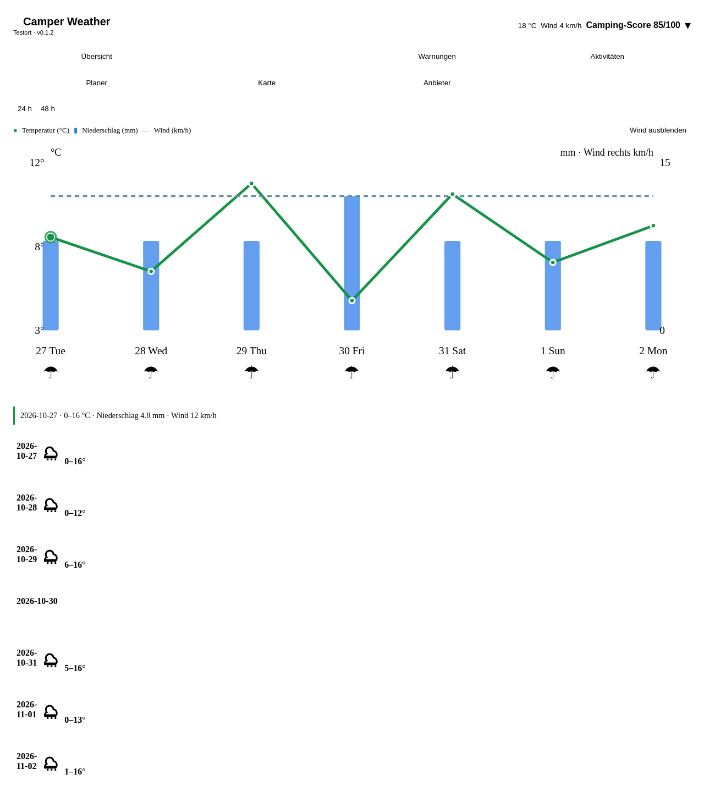

# Camper Weather

🇬🇧 **English** | [🇩🇪 Deutsch](README.md)

**Smart weather intelligence for Home Assistant and motorhomes** – forecasts,
DWD warnings, camping suitability, outdoor activity assessment and trip-target
planning in one Lovelace card.

> **v0.1.3 Stable** is the current GitHub release. It keeps the collapsed card
> header readable at narrow desktop, tablet and mobile widths. The official
> HACS catalog request is open but not yet accepted; custom-repository
> installation remains available.



*Product overview illustration. It is not a single live Home Assistant
screenshot and should not be treated as runtime evidence.*

## Features

- 24-hour, 48-hour and 7-day forecasts with temperature, precipitation and
  optional wind series
- Separate safety status (**green, yellow, orange, red or gray**) and comfort
  score from 0–100; neither is a guarantee of safe activity
- Camping score with readable weather reasons and data-quality context
- DWD warnings with time, geography and, where available, elevation checks;
  uncertain or unavailable data is shown as such
- Location modes for motorhome GPS, Home Zone, manual place search and saved
  destinations
- Activity planner for walking, hiking, cycling, e-bike, jogging, skiing,
  swimming, barbecuing, fishing and other configured activities
- Independent planner target coordinates, saved activities and editable time
  windows
- MapLibre map and RainViewer radar, initialized when the map section is opened
- Home Assistant sensors and the read-only action
  `camper_weather.evaluate_window`
- No automatic control of awnings, valves or other devices

## Lovelace screenshots









The collapsed-card and chart images are actual browser test screenshots. The
overview image above is explicitly a product/marketing illustration. The
repository currently does not include separate runtime screenshots for every
expanded tab, DWD warning state, activity list, planner, map and radar state;
the user guide documents those sections without presenting illustrations as
live screenshots.

## Requirements

- Home Assistant **2026.10.4 or newer recommended**
- HACS or a manual custom-integration installation
- Network access to the configured weather, warning, geocoding, map and radar
  providers

## Installation

The request to add Camper Weather to the official [HACS default repository](https://github.com/hacs/default/pull/12942)
is open and its automated checks are passing, but maintainer acceptance has not
yet occurred. Until then:

1. Open **HACS → Integrations → ⋮ → Custom repositories**.
2. Add `balronu/ha-camper-weather` with category **Integration**.
3. Install stable `v0.1.3`.
4. Go to **Settings → Devices & services → Add integration** and select
   **Camper Weather**.

After an official catalog acceptance, the normal HACS search can be used. No
second Marketplace submission is needed.

## Setup and location management

Configure a name, weather provider and update interval, then choose a
motorhome tracker, Home Zone or fixed coordinates. The card can switch between
motorhome GPS, Home, a manually searched place and a saved destination. A
planner target has its own coordinates and does not silently change the global
weather location.

Add the card from the visual editor or use YAML:

```yaml
type: custom:camper-weather-card
entry_id: YOUR_CONFIG_ENTRY_ID
```

`entry_id` is only required when multiple Camper Weather config entries exist.
The integration registers its JavaScript resource automatically.

## Forecasts and DWD warnings

The forecast offers 24 hours, 48 hours and 7 days. The chart keeps
precipitation amount (mm), precipitation probability (%) and wind (km/h) as
separate values. Missing precipitation remains unknown rather than being
displayed as zero.

DWD warnings are treated as locally confirmed only when the available warning
geometry, time range and elevation information support that conclusion.
Unclear geography is shown as possible or undetermined. A DWD/provider outage
is not an all-clear.

## Safety, comfort and camping score

Safety describes detected weather and warning risks. Gray means the available
data is insufficient for a reliable classification. Comfort is a separate
0–100 assessment of conditions such as temperature and wind. The camping score
summarizes suitability and reasons; none of these values is a safety promise.

## Activities and time windows

Choose an activity, date, start time and duration. Review the returned comfort,
safety, data-quality and reason fields before saving an activity. Saved planner
activities retain their target coordinates and can be edited. Past activities
are not silently reassessed.

For automations, the integration exposes the read-only action:

```yaml
action: camper_weather.evaluate_window
data:
  entry_id: YOUR_CONFIG_ENTRY_ID
  activity: hiking
  start_at: "2026-10-28T10:00:00+01:00"
  duration_minutes: 120
```

## Map and radar

The map section uses MapLibre and available OpenFreeMap layers; RainViewer
provides available radar frames. Map and radar services are external and may
be unavailable. The card reports provider errors and keeps source information
visible.

## Data providers and privacy

Depending on configuration, Camper Weather uses Open-Meteo, optionally MET
Norway, DWD warnings, RainViewer and OpenFreeMap. Their own terms and
availability limits apply. Camper Weather does not store a GPS history and does
not put provider credentials in the frontend. Public providers receive only
the location and weather parameters required for a request. See
[provider/API notes](docs/provider-api-keys.md).

## Known limitations and troubleshooting

- DWD matching depends on available geometry and elevation data.
- Public weather, map, radar and geocoding services have no availability
  guarantee.
- Swimming, skiing and similar activities are not fully safety-certified by
  specialized water, snow or avalanche data.
- If weather is missing, inspect the **Providers** tab and its last-successful
  update and data-quality fields.
- If a tracker is unavailable, use Home or a manual location temporarily.
- For a blank map, check browser network access to MapLibre/OpenFreeMap and
  RainViewer.
- When several entries exist, set the correct `entry_id` in the card/action.

## Documentation and support

- [German installation](docs/INSTALLATION_DE.md)
- [English installation](docs/INSTALLATION_EN.md)
- [German user guide](docs/USER_GUIDE_DE.md)
- [English user guide](docs/USER_GUIDE_EN.md)
- [Architecture notes](docs/architecture.md)
- [Changelog](CHANGELOG.md)
- [Issues and support](https://github.com/balronu/ha-camper-weather/issues)
- [Stable release v0.1.3](https://github.com/balronu/ha-camper-weather/releases/tag/v0.1.3)

## License

Camper Weather is distributed under the repository's [MIT license](LICENSE).
